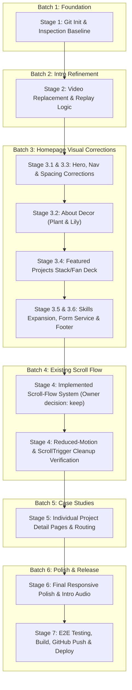

# FINAL CONSOLIDATED MASTER TO-DO LIST
**Project:** Keerthana Devan — Personal Portfolio Website (Portfolio 2.0)  
**Document Status:** Updated 2026-11-18 — Updated to reflect the implemented build; existing features are final.  
**Authority:** Single Source of Truth (combining Original PRD, 15 User Master Additions, and Technical Codebase Inspection)

---

## 1. The 15-Item Additions & Corrections Tracker

Every item from the approved additions list is tracked below and integrated into the seven-stage master plan:

| # | Addition / Correction | Target Area | Stage | Summary of Requirement |
| :---: | :--- | :--- | :---: | :--- |
| **1** | **Intro Character Video Replacement** | Intro Page | **Stage 2** | Replace existing waving WebM video with user-supplied video; maintain transparency, correct positioning, and responsiveness. |
| **2** | **Hero & Nav Action Button Swap** | Hero Section | **Stage 3.1** | Hero action buttons become **"View Projects"** and **"Download Resume"**. |
| **3** | **Navigation Menu Restructuring** | Header Nav | **Stage 3.1** | Nav items: **Home, About, Projects, Skills, Get in Touch, and Resume** (remove separate "Contact" nav item). |
| **4** | **Single-Line Hero Name** | Hero Section | **Stage 3.1** | Keep "Keerthana Devan" on a single line across all viewports (including mobile) without excessive font reduction or italicisation. |
| **5** | **Hero Viewport Fill** | Hero Section | **Stage 3.1** | Burgundy background fills initial viewport completely ($100\text{vh}$ / $100\text{svh}$); the dividing wave and ivory section reveal only upon user scroll. |
| **6** | **Black Plant Decor Accent** | About Section | **Stage 3.2** | Position user-supplied black botanical branch beside the Polaroid photo, matching approved mock proportions. |
| **7** | **Bottom-Left Red Lily Restoration** | About / Education | **Stage 3.2** | Restore user-supplied high-res red lily at the bottom-left; prevent clipping or over-edge positioning. |
| **8** | **Polaroid Integration Refinement** | About Section | **Stage 3.2** | Refine Polaroid integration and shadow against the warm ivory background; preserve original photograph. |
| **9** | **Section Spacing & Precise Alignment** | Global / Sections | **Stage 3.3** | Reduce vertical gaps between About, Education, and Leadership; align Projects arrow with heading; align Skills title & copy. |
| **10** | **Parallel Stack and Hover Fan** | Featured Projects | **Stage 3.4** | Begin with an aligned stack; fan on hover or focus and return to stack when interaction ends. |
| **11** | **Project Deck Interaction** | Featured Projects | **Stage 3.4** | Cycle projects with Next, dots, exposed-card selection, and front-card drag while preserving deck animations. |
| **12** | **Stable Project Information Panel** | Featured Projects | **Stage 3.4** | Keep the info column height stable while project details swap cleanly. |
| **13** | **Complete Technical Skills List** | Technical Skills | **Stage 3.5** | Add MySQL, SQL, and verified technologies Keerthana can explain; include official brand logos and hover brand colors. |
| **14** | **Functional Contact Service & Footer Cleanup** | Contact & Footer | **Stage 3.6** | Remove redundant bottom footer row; replace `mailto:` with direct submission service (Formspree/EmailJS) with validation, loading, success/error states, and spam protection. |
| **15** | **Scroll-Flow System** | Global Motion | **Stage 4** | Existing GSAP `data-reveal` entrance reveals and `useScrollFlow.js` scroll flow; Projects uses its own `PROJECTS_FLOW` config. Owner decision: keep as is; no further proposal required. |

---

## 2. Key Inspection Findings Incorporated Into the Plan

The following critical technical and structural items discovered during the codebase inspection are incorporated into their respective stages:

1. **Routing Setup (`src/app/App.jsx`)**: Routes currently include `/`, `/intro`, and `/portfolio`; no `/projects/:id` route exists yet, so project detail routing remains in Stage 5.
2. **Case Study Data Model (`src/data/portfolioContent.js`)**: Project data includes card summaries, descriptions, tags, repository/demo URLs, status, and tech stacks, but not structured case-study sections (*The Problem, The Solution, Key Features*).
3. **Session Replay State**: `App.jsx` and `IntroPage.jsx` use the session flag to skip a previously completed intro. Replay is supported through `/intro` or `?replay=true`; the UI has a Skip Intro button and no visible replay button.
4. **GSAP Context Lifecycle**: GSAP Flip and ScrollTrigger instances must maintain strict component lifecycle cleanup (`context.revert()`) to prevent ghost memory leaks on route changes.
5. **Project Deck Interaction**: the three-card stack supports fan/stack states, cycling, card selection, and drag; separate project-detail routes remain a Stage 5 item.
6. **Mobile Touch Handling**: the deck distinguishes touch interaction from hover so touch users can fan, select, and drag cards without changing page scroll behavior.
7. **Production Build Integrity**: Continuous validation via `npm run build` at every milestone to guarantee zero bundle regression.

---

## 3. Rejected or Outdated Interpretations (Do NOT Implement)

* ❌ **Do NOT move the "Skip Intro" button below Portfolio Series**: Per latest explicit decision, **Skip Intro remains in the top-right corner** matching the approved reference.
* **Keep the existing scroll motion:** The current build deliberately includes GSAP `[data-reveal]` entrance reveals and the `useScrollFlow.js` scroll flow. Owner decision: keep both unchanged.
* ❌ **Do NOT introduce a particle cursor**: Particle cursor is explicitly excluded until separately requested and approved.
* ❌ **Do NOT alter or replace the K-Logo math**: The scale-down, coordinate-shift, and letter-by-letter stagger in `IntroPage.jsx` are working and protected.
* ❌ **Do NOT redesign the homepage layout**: Adhere strictly to the approved reference layout.
* ❌ **Do NOT add unrequested sections**: No Certifications section, no Blog, no Admin CMS, and no System Architecture diagrams on project pages.
* ❌ **Do NOT invent metrics or data**: Never fabricate user counts, download numbers, or fictitious live demo links.

---

## 4. Staged Master Asset & Information Requirements

Assets will only be requested from the user at the start of their respective stages:

* **Stage 2 (Intro)**:
  * [x] Replacement intro character waving video (`.webm` with transparent alpha channel or `.mp4` + fallback).
* **Stage 3 (Homepage Corrections)**:
  * [x] High-resolution transparent PNG of the **black plant** (beside Polaroid — integrated & verified).
  * [x] High-resolution transparent PNG of the **red lily** (bottom-left placement — integrated & verified).
  * [ ] High-fidelity project screenshots for **SignBridge**, **UniX**, and **SkySense** expanded card views.
  * [x] Confirmed list of technical skills to add (MySQL, SQL, React, VS Code, Git, Python, Java — integrated & verified).
  * [ ] Destination email address and Formspree Form ID / EmailJS service keys.
* **Stage 5 (Individual Project Pages)**:
  * [ ] Approved visual reference screenshot for the Project Detail page layout.
  * [ ] Project case-study copy for UniX and SkySense (*Problem, Solution, Key Features*).
  * [ ] Verified GitHub repository URLs and active Live Demo URLs (or confirmation to mark demo unavailable).
* **Stage 6 (Final Audio & Polish)**:
  * [ ] Audio sound assets: K emergence whoosh, settling resonance impact, and subtle letter typing ticks.

---

# THE CONSOLIDATED MASTER TO-DO LIST

---

### STAGE 1 — Resume Existing Work, Baseline & Inspection

> **Objective:** Verify existing foundation, ensure build stability, and establish clean version control without modifying application code.

- [x] **1.1 Version Control Initialization** *(Technical Finding)*
  - [x] Initialize Git repository (`git init`).
  - [x] Verify `.gitignore` covers `node_modules/`, `dist/`, `.env`, and OS artifacts.
  - [x] Create baseline commit of existing verified working code.
- [x] **1.2 Inspection & Runtime Baseline Verification**
  - [x] Run local development server (`npm run dev`) and inspect console output.
  - [x] Run production build (`npm run build`) to ensure baseline passes with 0 errors.
  - [x] Verify existing K-logo letter reveal sequence on desktop and mobile viewports.
  - [x] Verify existing character video playback and fallback rendering.
  - [x] Document exact current dimensions and offsets of all sections before touching CSS.

---

### STAGE 2 — Intro Section

> **Objective:** Update the intro character video, preserve established emergence motion, ensure top-right button placement, and implement proper session replay handling.  
> **Dependencies:** User-supplied new intro video asset.

#### Functional Requirements
- [x] **2.1 New Character Video Integration** *(Addition #1)*
  - [x] Replace `intro-character-waving-transparent-full.webm` with the new user-supplied video.
  - [x] Maintain transparent alpha channel rendering and hardware-accelerated playback.
  - [x] Verify animated fallback (`.webp` / static poster) for browsers lacking VP9 alpha support.
- [x] **2.2 Controls & Navigation Lifecycle** *(Inspection Finding)*
  - [x] Confirm "Skip Intro" button is positioned in the **top-right corner** per the approved design.
  - [x] Implement `sessionStorage` flag (`hasSeenPortfolioIntro`) upon Skip Intro click or animation completion.
  - [x] Ensure navigating back to `/portfolio` from any sub-page never triggers the intro again.
  - [x] Replay Intro through the `/intro` route or `?replay=true`; there is no visible replay button.
- [x] **2.3 Homepage Transition**
  - [x] Ensure seamless, glitch-free route transition from Intro (`/`) to Main Portfolio (`/portfolio`).
  - [x] Implement cinematic crossfade (0.85s natural, 0.38s skip) with portfolio mounted underneath.
  - [x] Eliminate hardcoded completion delays (immediate trigger on video `ended` event within ~124ms).

#### Visual & Styling Corrections
- [x] **2.4 Character Stage Positioning & Mobile Framing**
  - [x] Anchor character video to bottom-center of viewport without vertical clipping.
  - [x] Tune mobile container sizing (`width: min(136vw, 58rem, 96svh)`) to prevent horizontal scrollbars.
- [x] **2.5 Motion & Typography Integrity (Protected)**
  - [x] Preserve K logo scale-down and coordinate slide to the left.
  - [x] Preserve sequential letter typing of "EERTHANA DEVAN" in upright ivory serif font.
  - [x] Preserve "PORTFOLIO SERIES" fine-line reveal and gold flourish.

---

### STAGE 3 — Homepage Corrections

> **Objective:** Implement all 15 layout, content, styling, interaction, and integration corrections across the main portfolio page.  
> **Dependencies:** Stage 1 baseline; user-supplied floral assets, project screenshots, and contact credentials.

#### 3.1 Hero Section & Navigation
- [x] **3.1.1 Action Buttons & Navigation Refinement** *(User Feedback & Additions #2 & #3)*
  - [x] Hero Action Buttons: Primary = **"View Projects ↗"**, Secondary = **"Download Resume"** (with down arrow tray icon, downloading `Keerthana_Devan_Resume.pdf`).
  - [x] Navigation links: **Home (`#home`), About (`#about`), Projects (`#projects`), Skills (`#skills`), Get in Touch (`#contact`)**.
  - [x] Removed duplicate "Resume" button from nav bar per user request to resolve navigation spacing/gap cleanly.
  - [x] Styled "Get in Touch" navigation item as a pill button (`border-radius: 999px`) across desktop and mobile.
  - [x] Maintained active section highlighting as the user scrolls.
- [x] **3.1.2 Typography & Hero Name Styling** *(Approved Reference Design & Single-Line Requirement)*
  - [x] Preserved exact approved reference font: Georgia Italic (`font-style: italic`, `font-family: Georgia, "Times New Roman", serif; font-weight: 400`).
  - [x] Formatted "Keerthana Devan" on **one single line** across all viewports (desktop, tablet, mobile) per user request.
  - [x] Actual `.hero-copy h1` font sizes: base `clamp(2.95rem, 6.35vw, 6.2rem)`; max-width 900px `clamp(2.35rem, 5.4vw, 4rem)`; max-width 680px `clamp(2.15rem, 8.2vw, 3.5rem)`; max-width 360px `clamp(1.75rem, 8.2vw, 2.05rem)`.
  - [x] `white-space: nowrap` is set on `.hero-copy h1` in the base rule and repeated in each of those three media-query rules.
- [x] **3.1.3 Full Viewport Burgundy Canvas** *(Addition #5)*
  - [x] Set `.hero-section` to fill the initial viewport completely (`min-height: 100vh; min-height: 100dvh;`).
  - [x] Positioned the transition wave at the bottom edge so the ivory section enters only upon scrolling.

#### 3.2 About Section
- [x] **3.2.1 Botanical Decor Integration** *(Additions #6 & #7)*
  - [x] Use the thinner restyled plant `public/assets/decor/black-plant-thin.png`, generated by `scripts/thin-black-plant.py` from `source-assets/decor/black-plant.png`.
  - [x] Reposition and restore **red lily** at the extreme bottom-left corner of the ivory section boundary (`bottom: 0; left: 0;`).
  - [x] Set exact boundary margins and section height so the lily is not cropped, trimmed, or overflowing into the burgundy section.
- [x] **3.2.2 Polaroid Integration Refinement** *(Addition #8)*
  - [x] Refine Polaroid shadow and tape styling to integrate naturally against the warm ivory background.
  - [x] Preserve Keerthana's original V-sign photograph without alteration or distortion.

#### 3.3 Section Spacing and Alignment
- [x] **3.3.1 Vertical Rhythm Adjustment** *(Addition #9)*
  - [x] Moderately reduce vertical padding between About, Education, and Leadership sections for a tight, cohesive editorial flow.
- [x] **3.3.2 Micro-Alignment Corrections** *(Addition #9)*
  - [x] Align Featured Projects arrow horizontally and vertically with the section heading.
  - [x] Align Technical Skills heading and intro description cleanly.
  - [x] Correct Leadership text offsets, padding, and bottom-left floral positioning with zero content collision.

#### 3.4 Featured Projects Card Deck
- [x] **3.4.1 Parallel Stack and Fan States**
  - [x] The cards rest in a parallel stack and fan into the staggered, tilted layout on deck or Next Project hover.
  - [x] Next keeps the deck fanned while interaction remains; it returns to the stack when pointer/focus leave. Keyboard focus also triggers the fan (`onFocusCapture` in `ProjectsSection.jsx`); touch and reduced-motion paths are implemented.
- [x] **3.4.2 Deck Navigation and Drag**
  - [x] Keep Next, project dots, exposed-card selection, and front-card dragging working across stack and fan states.
  - [x] Preserve the existing animated card cycle and info-panel swap.
- [x] **3.4.3 Project Screenshot Fit**
  - [x] Use dedicated UniX and SkySense card images while keeping the original source screenshots outside public assets.
  - [x] Keep SignBridge rendering unchanged.
- [ ] **3.4.4 Browser Verification**
  - [ ] Verify stack, fan, drag, Next, dots, and screenshot fit at desktop, tablet, and mobile widths.

#### 3.5 Technical Skills Section
- [x] **3.5.1 Skills Inventory Expansion** *(Addition #13)*
  - [x] Update `portfolioContent.js` with complete, verified skills (including MySQL, SQL, React, VS Code, Git, Python, Java).
- [x] **3.5.2 Visual Badges & Brand Interactions** *(Addition #13)*
  - [x] Add official SVG/PNG logos for all technologies.
  - [x] Implement brand-specific background and accent colors on hover for each skill badge.
  - [x] Ensure responsive multi-column alignment and balanced grid spacing.

#### 3.6 Contact Section
- [x] **3.6.1 Direct Formspree Submission**
  - [x] Submit from the site with fetch using `VITE_FORMSPREE_ENDPOINT`; keep the visible email link as a normal contact link.
  - [x] Validate name, email, and message; show field-level errors and a disabled sending state with spinner.
  - [x] Include a honeypot and a subject line; do not send when the honeypot is filled.
  - [x] Reset on success and show dismissible success/error toasts; preserve input on failure.
  - [x] `.env.example` exists with only `VITE_FORMSPREE_ENDPOINT=`; `.env` remains ignored.
- [ ] **3.6.2 Live Delivery Verification**
  - [ ] Submit a real message in the browser and confirm delivery to the configured inbox.

### Site Metadata and Floating Navigation
- [x] **Favicon and Install Metadata**
  - [x] Link the logo-derived favicon, Apple touch icon, and web manifest from `index.html`.
  - [x] Keep the manifest's 192px and 512px icons in `public/`.
- [x] **Floating Section Menu**
  - [x] The toggle and open panel follow section theme: cream over burgundy sections and burgundy over cream sections. The active item is a gold pill; "Home" is never styled as active in this menu. Keyboard support and drag behavior are implemented.
- [ ] **Browser Verification**
  - [ ] Verify favicon loading and floating-menu contrast/navigation in a browser across desktop and mobile sizes.

---

### STAGE 4 — Implemented Scroll-Flow System

> **Objective:** Preserve the implemented scroll-flow and entrance-reveal behavior.  
> **Status:** Replaced by the implemented scroll-flow system (`src/hooks/useScrollFlow.js`, `data-scroll-flow` elements, with Projects using its own `PROJECTS_FLOW` config). Owner decision: keep as is; no further proposal required.

- [ ] **4.3 Accessibility & Cleanup Verification** *(Inspection Finding)*
  - [ ] Verify `prefers-reduced-motion: reduce` behavior for scroll flow and Projects animation; needs browser verification.
  - [ ] Verify ScrollTrigger cleanup/reversion on unmount; needs browser verification.

---

### STAGE 5 — Individual Project Pages

> **Objective:** Build reusable case-study pages for SignBridge, UniX, and SkySense following the approved project detail reference.  
> **Dependencies:** User-supplied Phase 3 reference, case-study copy, screenshots, and verified links.

> **Current project detail UI:** Until real links and case-study copy exist, the `View Repository` / `Live Demo` actions in `ProjectsSection.jsx` serve as the project detail UI. The `repoUrl` and `liveUrl` values in `portfolioContent.js` are placeholders to be replaced with the owner's original links later. No `/projects/:id` routes exist yet in `src/app/App.jsx`; link validity needs browser verification.

- [ ] **5.1 Architecture & Routing** *(Inspection Finding)*
  - [ ] Create `src/pages/ProjectDetail/ProjectDetailPage.jsx` and `projectDetail.css`.
  - [ ] Register dynamic routes in `src/app/App.jsx` (`/projects/:id`).
  - [ ] Implement scroll-to-top on route change.
- [ ] **5.2 Content Model Structure (`src/data/portfolioContent.js`)**
  - [ ] Expand data model for each project with strict section fields:
    - *The Problem*
    - *The Solution*
    - *Key Features* (bulleted list)
    - *Technology Tags*
    - *Project Links* (GitHub Repository URL & Live Demo URL)
    - *Status* (SignBridge strictly marked "Under Development")
- [ ] **5.3 Reusable Layout Implementation (Strict PRD Compliance)**
  - [ ] Display Technology Tags prominently near top.
  - [ ] Place GitHub Repository and Live Demo links **immediately below technology tags near the top** (not at bottom).
  - [ ] Prominently display **"Under Development"** status banner on SignBridge.
  - [ ] If a project lacks a live demo, clearly mark it as unavailable or omit the button (no placeholder/fake URLs).
  - [ ] Omit unrequested sections (no System Architecture, no metrics, no user counts).
- [ ] **5.4 Project Screenshot Showcase**
  - [ ] Display verified project screenshots preserving native aspect ratios.
  - [ ] Include back navigation link leading directly back to the main portfolio project section (`/portfolio#projects`).

---

### STAGE 6 — Final Visual Polish & Cinematic Intro Audio

> **Objective:** Refine responsive layouts, cross-browser styling, micro-interactions, and introduce deferred cinematic audio for the intro sequence.  
> **Dependencies:** User-supplied sound effect audio files.

- [ ] **6.1 Cross-Device & Responsive Polish**
  - [ ] Audit layouts at standard breakpoints: Desktop ($1440\text{px}$, $1200\text{px}$), Tablet ($1024\text{px}$, $768\text{px}$), Mobile ($480\text{px}$, $375\text{px}$).
  - [ ] Eliminate any horizontal overflow, clipped headings, or overlapping absolute elements.
  - [ ] Verify touch tap-target sizes ($\ge 44\text{px}$) for navigation, buttons, and card triggers.
- [ ] **6.2 Cinematic Intro Audio Integration**
  - [ ] Integrate K emergence whoosh sound effect synchronized with initial scale-down.
  - [ ] Integrate subtle settling impact/resonance sound when the K locks into position.
  - [ ] Integrate optional subtle letter typing ticks during name reveal.
  - [ ] Add accessible sound toggle control (Mute/Unmute) with default respect for user autoplay policies and reduced-motion settings.

---

### STAGE 7 — Testing, Build & Deployment

> **Objective:** Comprehensive end-to-end verification, production build validation, and live deployment.

- [ ] **7.1 Functional Verification Checklist**
  - [ ] Test every navigation link (`Home`, `About`, `Projects`, `Skills`, `Get in Touch`, `Resume`).
  - [ ] Test resume PDF download from both Nav and Hero.
  - [ ] Verify project stack/fan transitions, Next, dots, exposed-card selection, and drag at desktop and mobile sizes.
  - [ ] Test project detail page links, back navigation, and verified external GitHub/Demo URLs.
  - [ ] Verify contact form field errors, success/error toast behavior, and delivery to the configured inbox.
  - [ ] Test "Skip Intro" button, session persistence, and replay flow.
  - [ ] Verify favicon requests and floating-menu contrast, navigation, drag, and keyboard behavior in a browser.
- [ ] **7.2 Build & Code Quality**
  - [ ] Run `npm run build` and confirm production bundle builds with 0 errors and 0 warnings.
  - [ ] Check browser developer tools console for zero runtime errors or unhandled promises.
  - [ ] Audit accessibility: keyboard navigation focus rings (`:focus-visible`), image `alt` attributes, ARIA attributes.
- [ ] **7.3 Git Commit & Remote Repository Setup**
  - [ ] Stage all verified files and create semantic commit history.
  - [ ] Push repository to Keerthana's GitHub account (`Keerthana205`).
- [ ] **7.4 Deployment & Live Verification**
  - [ ] Deploy production build to hosting provider (e.g., Vercel, Netlify, or GitHub Pages).
  - [ ] Perform live end-to-end review on actual desktop and mobile devices.

---

## 5. Recommended Implementation Order & Batches

---

## 6. Implemented Features Beyond the Original Plan

- **2px gold scroll-progress rail** — `src/pages/Portfolio/PortfolioPage.jsx`, `src/pages/Portfolio/portfolio.css`. Owner decision: keep.
- **Hero pin with 3D recede and fade** (`.hero-pin` / `.hero-inner`) — `src/pages/Portfolio/PortfolioPage.jsx`, `src/pages/Portfolio/components/HeroSection.jsx`, `src/pages/Portfolio/portfolio.css`. Owner decision: keep.
- **Eased wheel-scroll smoothing** — `src/pages/Portfolio/PortfolioPage.jsx`. Owner decision: keep.
- **Hero text character-by-character entrance** — `src/pages/Portfolio/components/HeroSection.jsx`. Owner decision: keep.
- **Themed contact toast popups** — `src/pages/Portfolio/components/ContactSection.jsx`, `src/pages/Portfolio/portfolio.css`. Owner decision: keep.
- **Draggable floating menu** — `src/pages/Portfolio/components/FloatingNav.jsx`, `src/pages/Portfolio/portfolio.css`. Owner decision: keep.
- **Project info-panel repository/demo actions** — `src/pages/Portfolio/components/ProjectsSection.jsx`, `src/pages/Portfolio/portfolio.css`. Owner decision: keep.

## 7. Open Maintenance Work

- [x] **(a) Native wheel scrolling and router-based anchor navigation** — `PortfolioPage.jsx` checks scrollable ancestors before intercepting wheel input and updates hashes through React Router navigation. Verified by source inspection.
- [x] **(b) ESLint setup and findings** — flat config and `npm run lint` script are present; `npm run lint` completed with no findings.
- [x] **(c) Dependency audit and contact-form hardening** — max lengths, 15-second abort timeout, double-submit guard, `.env.example`, and Open Graph/Twitter tags are present; `npm audit` and `npm audit --omit=dev` both report 0 vulnerabilities.
- [x] **(d) WebP compression with originals retained** — converted assets are in `public/assets/`; PNG originals are retained in matching `source-assets/` folders.
- [x] **(e) Skip Intro desktop typography/alignment** — serif font and desktop right-edge alignment are set in `src/pages/Intro/intro.css`; mobile offsets remain in its media queries.
- [ ] **(f) Replace project placeholder links** — `repoUrl` / `liveUrl` still need the owner's original links; link validity needs browser verification.

